<p align="center">
  
</p>

# BrandGuard AI

Evidence-gated pre-publication brand governance. A review holds a draft against a published brand kit. Findings cite approved sources from that retrieval, or they name the evidence gap. A person accepts suggestions and approves the draft. Review output never sets a draft to `approved`.

**Provisional name:** Round 1 research notes identify a public commercial page using this name. Confirm naming and clearance before public use.

The pictures below are the running app. Seeded Inkloom facts are demo data. On the saved reviews in these shots, the optional model pass did not return usable JSON, so the findings on screen are the deterministic ones. The public landing demo does not call a model, does not save a review, and does not approve the draft.


## See the process

The landing page, from the hero through one deterministic pass on the fictional Northline kit:


The workspace, from sign-in through a human approval. Each frame is a screen from the steps below.

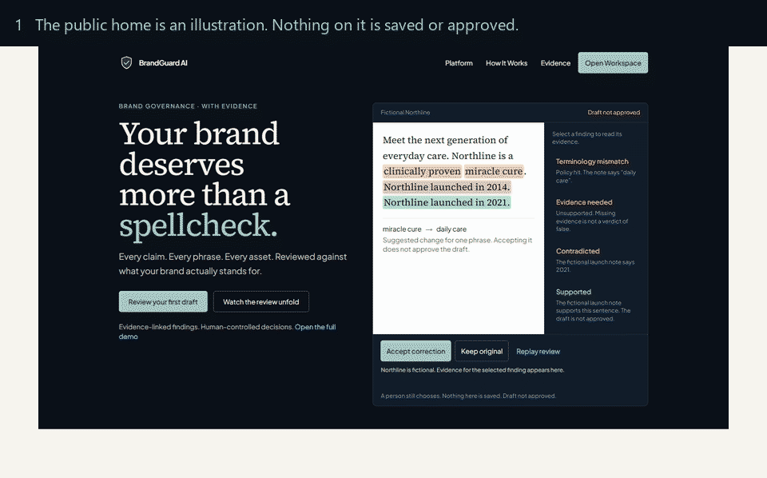


## 1. Public home

`/` walks through the fictional Northline kit: a terminology mismatch, an unsupported claim, a contradicted launch year, and a sentence the fictional note supports. That screen is an illustration. It is not a stored review. Signed-in visitors can open the workspace. Signed-out visitors sign in from the same page.

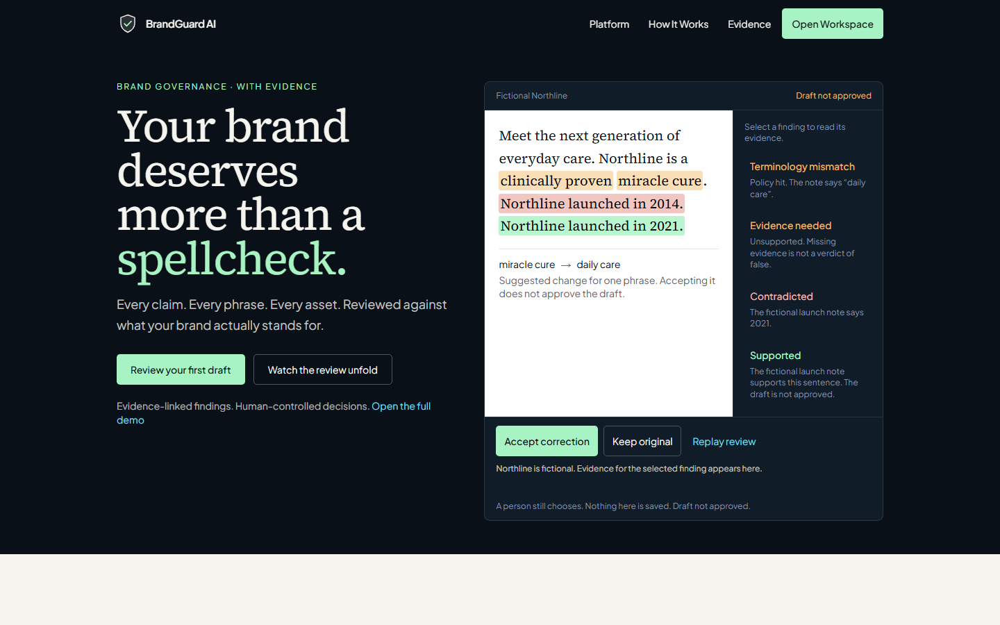


## 2. Try the evidence gate

The landing studio runs the same deterministic reviewer used in the workspace, against the fictional kit only. After the pass, this draft shows one supported sentence, one contradicted year, one unsupported claim, and one terminology mismatch. Counts appear only after that pass. Accepting the suggested phrase updates the preview. The draft stays unapproved, and nothing is saved.

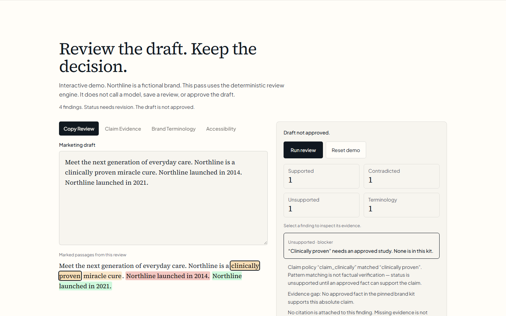

The same page states what the product does in four steps. Terminology, promotional claims, factual claims, and color checks against published tokens are implemented. A full accessibility audit and logo review are not built. Approval is a separate action, and the product does not publish on its own.

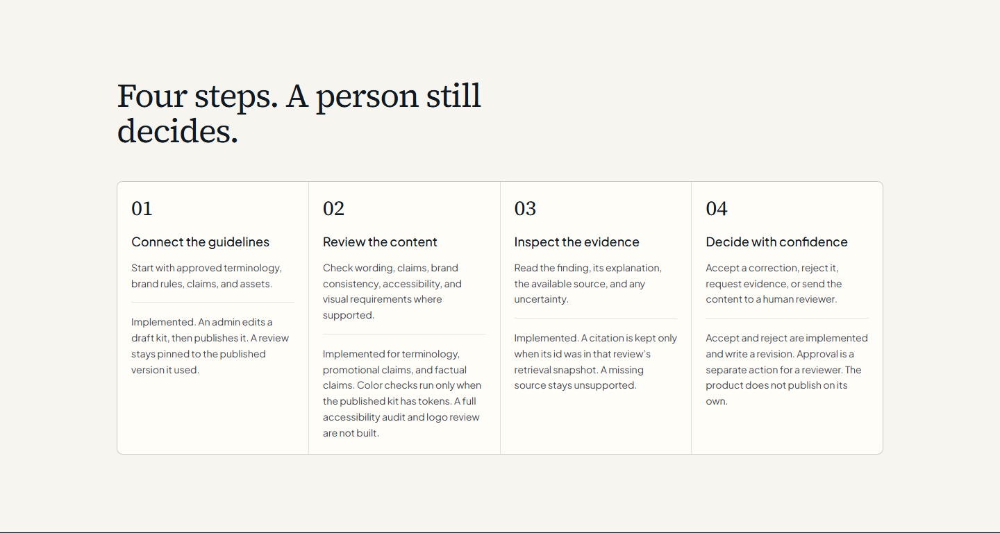


## 3. Sign in

Roles are stored with the user. Every later approval reads that role from the session, and every review query is limited to the user’s organisation. The sign-in page lists each demo role so a judge can enter quickly. That list is a judging convenience.

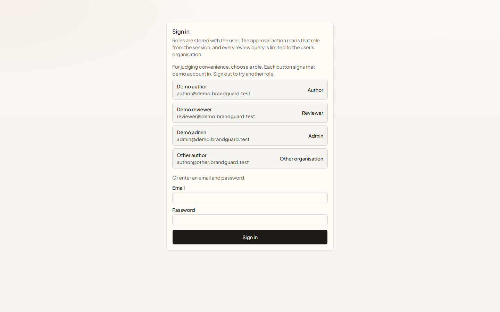


## 4. Write a draft

An author sets a title, goal, audience, channel, and phrases that must stay. The new-review screen opens with sample Inkloom copy. That copy is not a saved review until **Run review**.

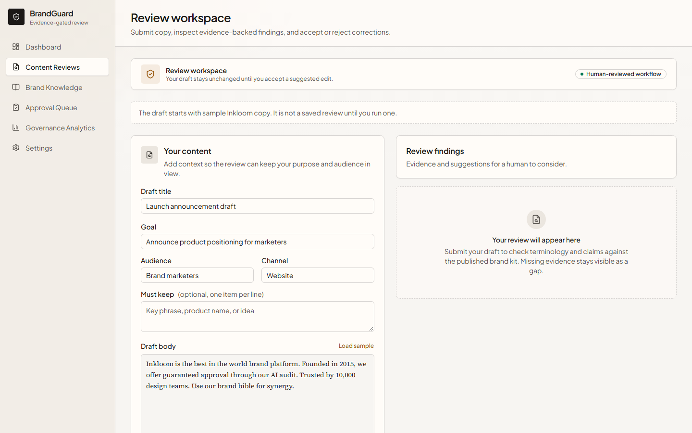

The mixed draft used for the findings below is:

```text
Inkloom was founded in 2019. Later copy says founded in 2015. We are the best in the world.
```


## 5. Read the findings

The review pins brand kit `1.0.0`. This run returned three deterministic findings:

- **Verified** — “Inkloom was founded in 2019” matches the published founding fact, with that excerpt.
- **Contradicted** — “founded in 2015” conflicts with the same fact.
- **Unsupported** — “best in the world” has no approved fact. That is an evidence gap. The status stays `unsupported`.

The review is `needs revision` because of the blocker. A markdown report downloads from this page. The report separates findings, suggested edits, the human decision, and the evidence-trust lines.

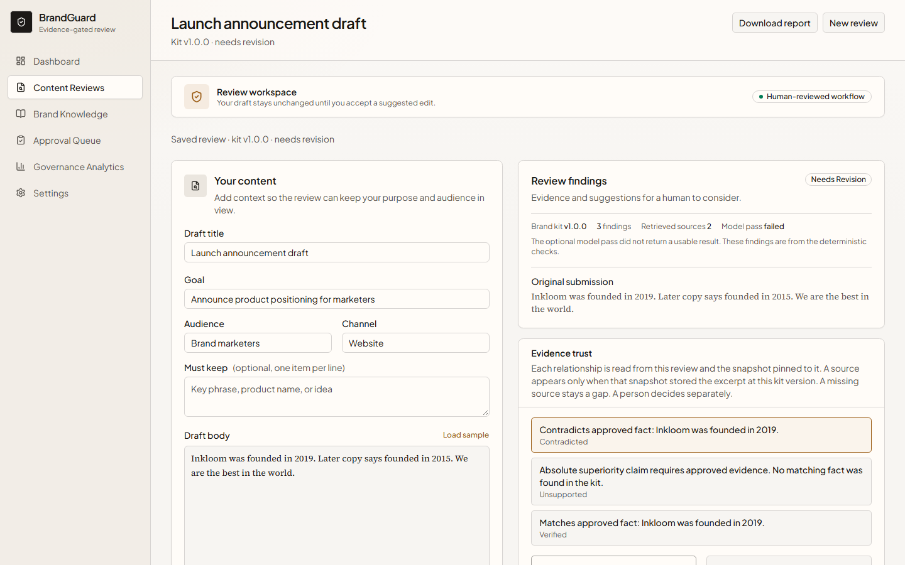


## 6. Inspect evidence trust

Evidence trust draws the selected finding as a relationship: the draft claim, the automated finding, and either a pinned source or an evidence gap. The same relationships are listed under the diagram as a text version. A source appears only when its id is in that review’s retrieval snapshot and the stored excerpt’s kit version is the review’s pinned version. The human decision is a separate block. On this review, none has been recorded. The diagram does not create citations, change a finding status, or approve the draft.

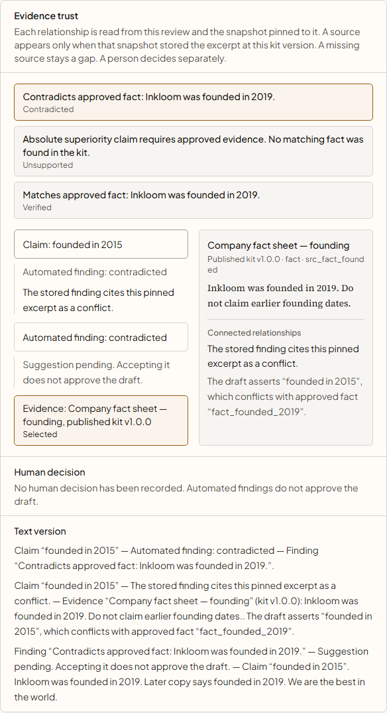


## 7. Accept a suggestion

Suggested edits are accepted or rejected by a person. Accepting the unsupported claim’s suggestion replaces “the best in the world” with qualified wording, writes a revision, and leaves the review status unchanged. Rejecting leaves the body unchanged.

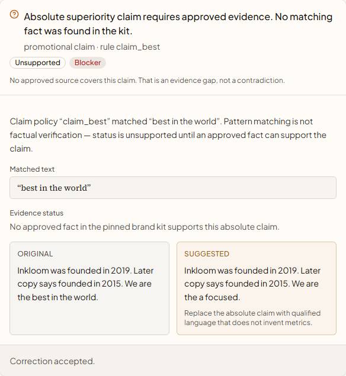


## 8. A clean draft can be decided

A second draft, `Inkloom was founded in 2019.`, has no blocker. It stays `in review`, kit `1.0.0`, with one verified finding and the pinned founding excerpt. The model pass failed on this run as well. The verified finding is the deterministic one.

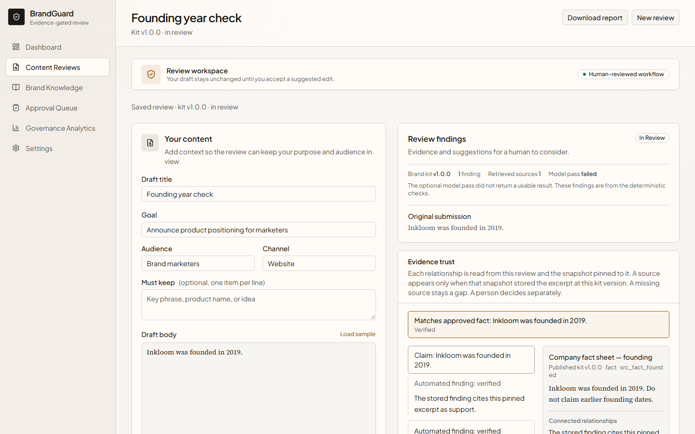


## 9. An author cannot approve

The queue lists reviews waiting on a person. Approve, request changes, and reject are checked on the server against the session role and the review’s current status. The mixed draft is `needs revision`, so Approve is not offered. The clean draft is `in review`. Choosing **Approve** as the author returns “Authors cannot approve reviews”. The status stays `in review`.

This development database also holds earlier demo drafts. Those rows are hidden in the picture so this step is readable.

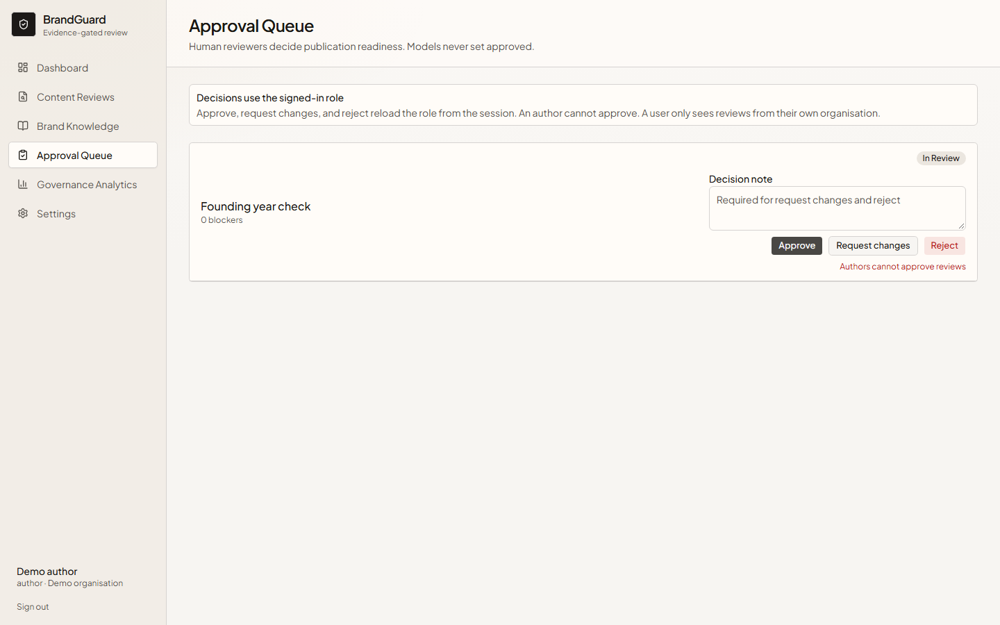

Request changes and reject require a short reason. The person who created a review cannot approve it, including a reviewer or admin who created it. A second concurrent decision does not write a second audit row. Audit events are append-only.


## 10. A reviewer approves

Signed in as the demo reviewer, **Approve** on that same draft stores the decision. The review is `approved · last decision approve`. The finding stays `verified`. The kit pin stays `1.0.0`. Evidence trust records the human decision separately from the automated finding.

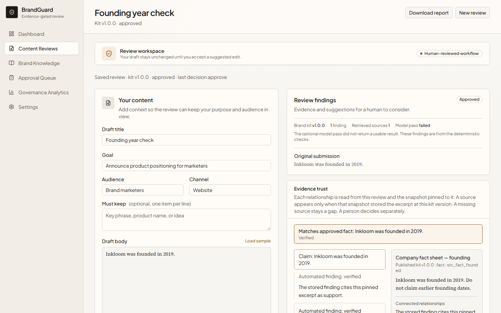


## 11. Publish the brand kit

An admin edits facts, term rules, and claim policies on a draft kit, then publishes the next version. Published versions stay pinned to the reviews that used them. A brand PDF can be read into candidate statements on the draft (a real `.pdf`, at most 2 MB). Those sentences are not approved until the kit is published. In this workspace, draft `1.0.1` is waiting and reviews still use published `1.0.0`.

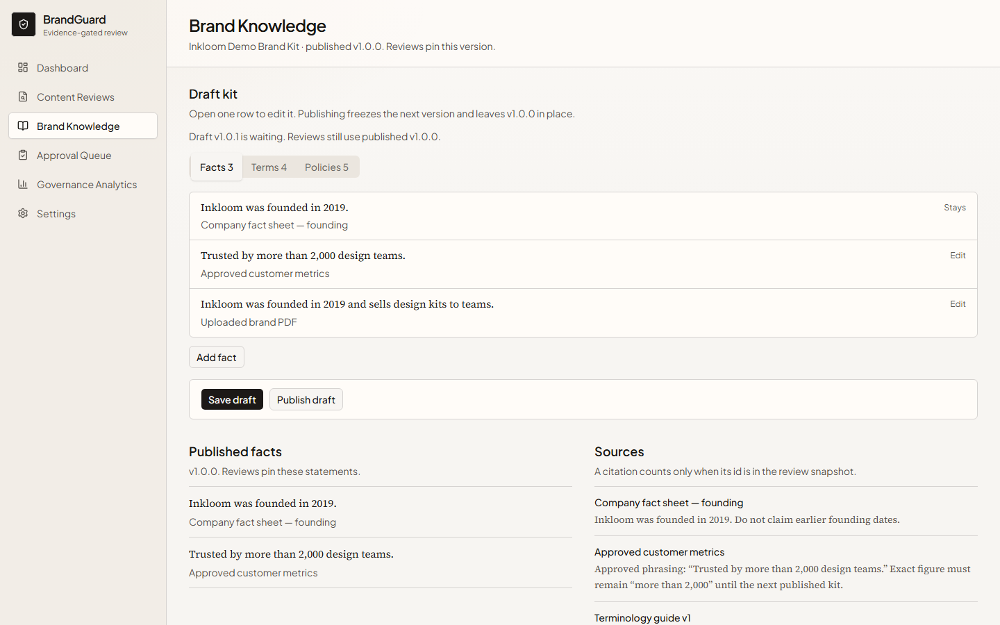


## 12. Analytics and settings

Governance analytics counts findings on stored reviews and scores the labelled fixture pack when the page loads. Recall there is the share of labelled expectations that matched. Precision is calculated only for fixtures marked exhaustive. The figures in the screenshot are what this development database showed when the image was taken. `npm run eval` prints the current fixture result. It does not print a hardcoded score.

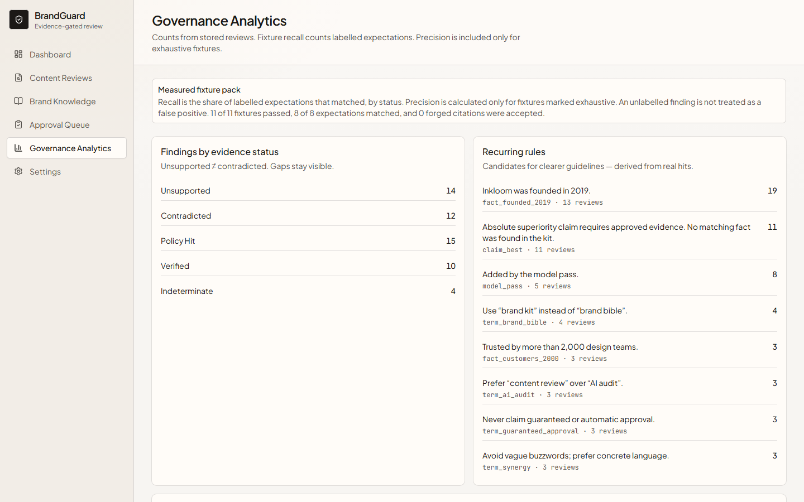

Settings shows the organisation, role, whether a free model id is configured, whether an OpenRouter key is present, and whether persistence is hosted Postgres or local Postgres. It does not show the key or the connection string.

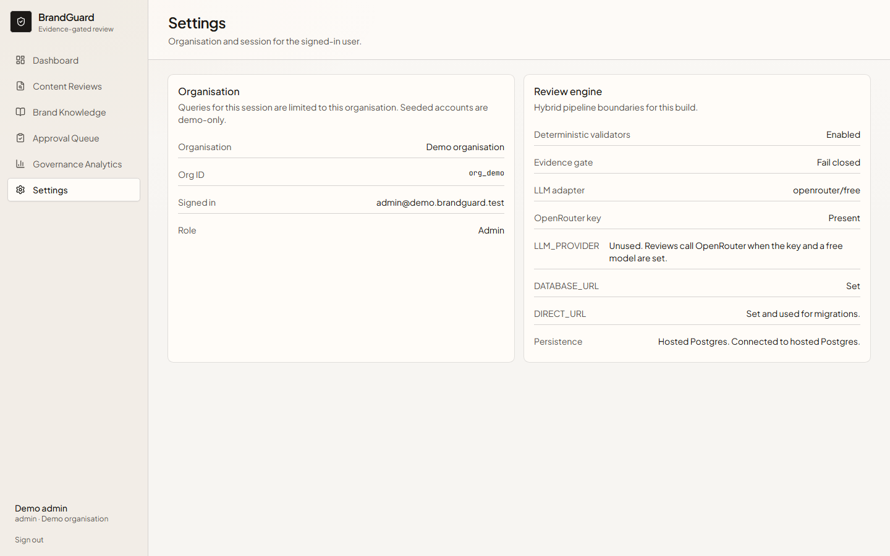


## How a review runs

1. Deterministic checks: terminology, approved facts, and claim policies. A hex color in the draft that is not a published token is a policy hit. A published token below 4.5:1 against the kit background is also a policy hit.
2. Lexical retrieval over the published kit. There is no vector index.
3. One model pass through OpenRouter, only when `OPENROUTER_API_KEY` is set and `LLM_MODEL` is `openrouter/free` or a single id ending in `:free`.
4. An evidence gate on the server. Citation ids outside that review’s retrieval snapshot are dropped. A model `verified` or `contradicted` verdict stays only when the cited excerpt contains that claim verbatim (at least 12 characters), the numbers match, and the local polarity matches the verdict. A short shared word, a bare year, or a paraphrase becomes `indeterminate`. The model cannot override a deterministic finding on the same span, and it cannot mark the draft approved.

Finding statuses are `verified`, `contradicted`, `unsupported`, `indeterminate`, `policy_hit`, and `suggestion_only`. A missing source is `unsupported` or `indeterminate`.

Login, review submission, and PDF inspection are limited per database: 30 sign-in attempts, 20 review submissions, and 8 PDF reads per 10 minutes. Instances that share `DATABASE_URL` share those counters. A separate embedded database does not limit other machines. If the counter cannot be written, the attempt is rejected.

A paid model id, or a fallback list that includes one, is refused and the model pass is not called. A missing key, a timeout, or malformed model JSON skips or fails that pass. Deterministic findings still return.

Accepting a suggestion updates the draft and leaves the review status unchanged. A demo script with accounts and expected results is in `DEMO.md`.


## Local run

```bash
npm install
npm run dev
```

Open [http://localhost:3000](http://localhost:3000).

Copy `.env.example` to `.env.local`. Do not commit `.env.local`.

**Local development.** Leave `DATABASE_URL` and `DIRECT_URL` unset. Reviews are stored in embedded Postgres under `.data/pglite`. `npm run dev` seeds demo accounts when the user table is empty. The sign-in page lists each demo role and signs that account in.

**Hosted database.** Set `DATABASE_URL` to the pooled connection and `DIRECT_URL` to a direct, non-pooler host. Migrations run on startup through the direct connection. If `DIRECT_URL` is missing or points at a pooler, the direct host is derived by removing `-pooler` from `DATABASE_URL`. The current hosted database already contains seeded demo accounts. Treat it as a development database. A public deployment needs a separate empty database. Production startup does not seed an empty database. The role buttons on the sign-in page work after those accounts exist.

**Optional model.** Set `OPENROUTER_API_KEY` and `LLM_MODEL=openrouter/free` (or one id ending in `:free`). A missing key skips the model pass. Malformed JSON is repaired once. A timeout, an empty response, or a second bad response fails that pass. Deterministic findings still return, and the review page says so without the provider error.

**Production.** Use a new database, do not seed demo accounts, and do not reuse the development password. Rate limits are shared only by instances that use that same database, and a failed counter write rejects the attempt.

The users table has no deactivation column. Do not delete the seeded users: `sessions.user_id` references `users.id`, and reviews and audit rows should stay. An administrator who has verified these ids can rotate credentials and clear sessions inside a transaction, after copying the current `password_hash` values to a private rollback note:

- `user_demo_author` — `author@demo.brandguard.test` — `org_demo`
- `user_demo_reviewer` — `reviewer@demo.brandguard.test` — `org_demo`
- `user_demo_admin` — `admin@demo.brandguard.test` — `org_demo`
- `user_other_author` — `author@other.brandguard.test` — `org_other`

Verify with `SELECT id, org_id, email, role FROM users WHERE id IN (...)`. Do not select `password_hash` into logs. Then update only those rows’ `password_hash` to a new hash and delete matching `sessions` rows. Rollback restores the saved hashes and does not touch reviews. This repository does not run that update. A separate production database is the safer release path.

All seeded accounts use the password `brandguard-demo`:

| Role | Email |
| --- | --- |
| Author | `author@demo.brandguard.test` |
| Reviewer | `reviewer@demo.brandguard.test` |
| Admin | `admin@demo.brandguard.test` |

An additional author account belongs to a separate seeded organisation for isolation checks: `author@other.brandguard.test`.


## Scripts

| Command | Purpose |
| --- | --- |
| `npm run dev` | Development server |
| `npm run build` | Production build |
| `npm run start` | Serve production build |
| `npm run test` | Unit and integration tests |
| `npm run eval` | Labelled fixture evaluation checks |
| `npm run typecheck` | TypeScript check |
| `npm run lint` | ESLint |


## Design system

Tokens live in `src/app/globals.css`: warm stone canvas, ink type, and a bronze accent. Persisted design research is under `design-system/brandguard-ai/`. The workspace is an information-dense review surface. The home page uses the same tokens.


## Further reading

- `AGENTS.md` — architecture and security constraints
- `DEMO.md` — judging script and expected findings
- `docs/round-1/06-architecture.md` — architecture and boundaries
- `docs/round-1/07-data-model-and-integrations.md` — data model and integration plan
- `docs/round-1/09-milestones.md` — milestone acceptance criteria
- `SKILLS.md` — reusable engineering workflows